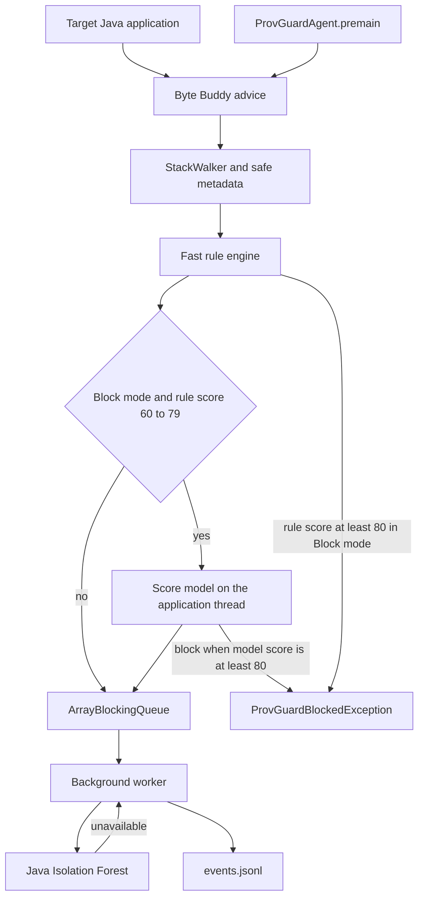

# Architecture

ProvGuard is a Java agent. The fast path runs on the application thread and can block only a confirmed rule match. Detailed logging and anomaly scoring run on one background worker.

The three instrumented methods are `Runtime.exec`, `ProcessBuilder.start`, and `ObjectInputStream.resolveClass`. A rule score of at least 80 can block on the application thread without waiting for the model. A rule score from 60 to 79 in Block mode scores the model on that same thread, with a 200 ms timeout, and blocks only when that score is at least 80. Every other event is queued, and the worker scores the model before writing the log. A stack trace from `StackWalker` is a call-path trace. It is not a provenance graph and it is not taint tracking.
