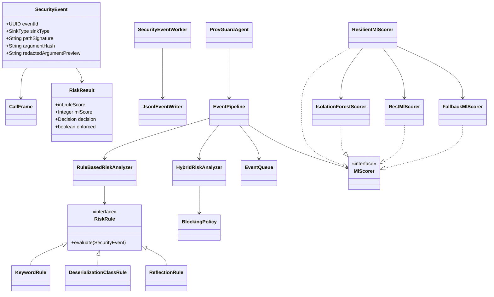

# Class diagram

`KeywordRule`, `DeserializationClassRule`, and `ReflectionRule` stand in for the full rule set in `provguard-rules`. Each rule returns a score delta. `BlockingPolicy` is the only place that turns those scores into allow, alert, or block. `ResilientMlScorer` is the scorer the agent constructs: an optional REST endpoint first, then the packaged Isolation Forest, then `FallbackMlScorer` when that model file is missing.
