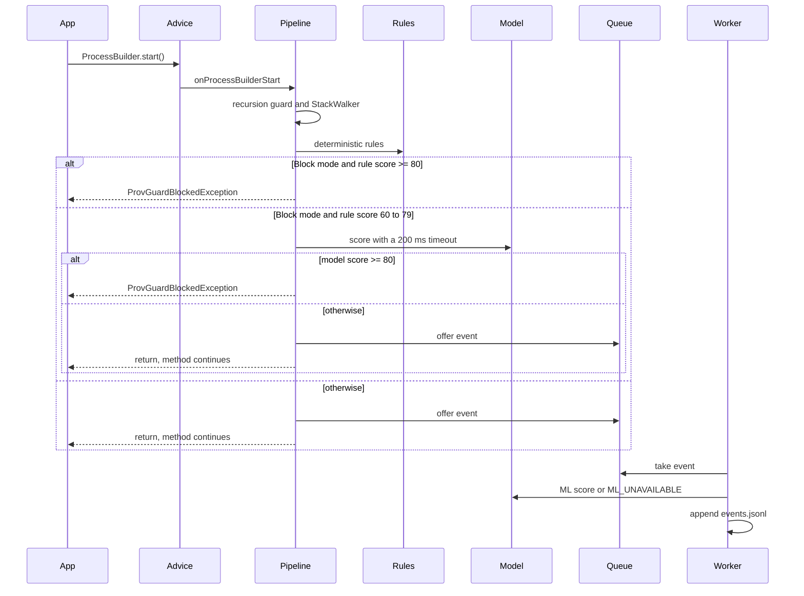

# Sequence: monitored process start

The synchronous model call happens only for the 60–79 band in Block mode. Other events are scored on the worker before they are written. The background worker never throws `ProvGuardBlockedException`. If the queue is full, the event is dropped and the application continues.
